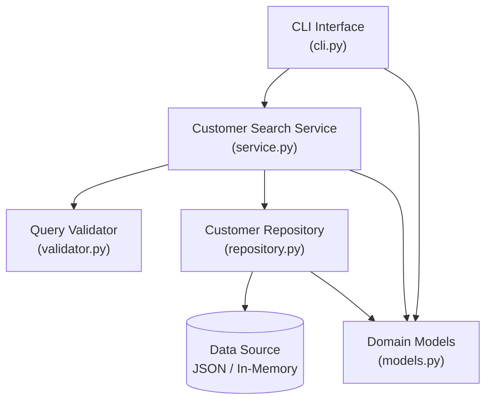
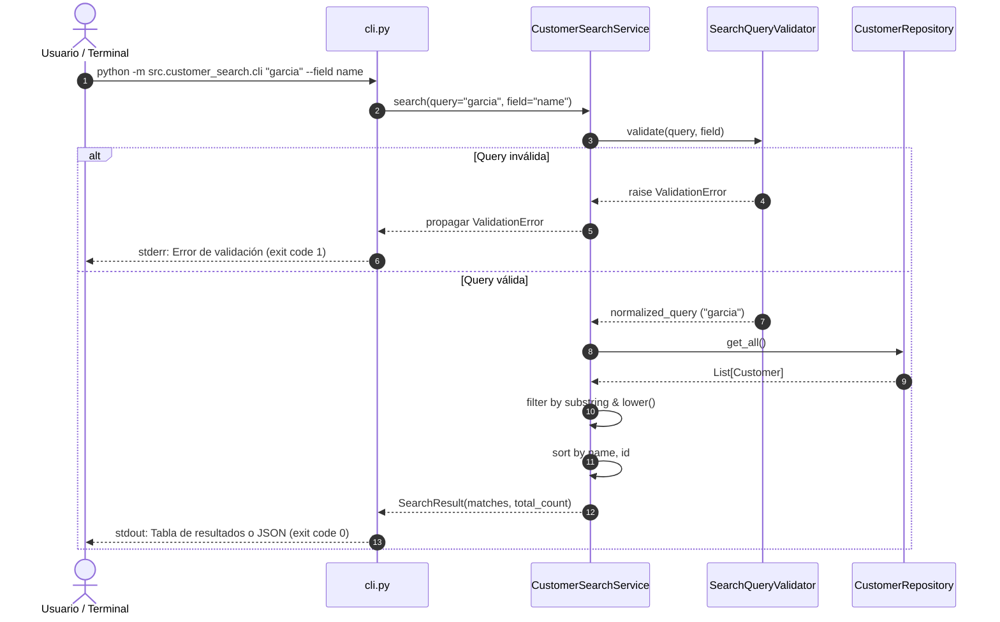

# Architecture

## Overview
La arquitectura de **Customer Search** sigue un diseño limpio en capas (*Clean / Layered Architecture*) orientado a la separación estricta de responsabilidades, desacoplando completamente la capa de presentación (CLI) de la lógica de dominio, validación y acceso a datos.



## Components
1. **Domain Layer (`src/customer_search/models.py`)**:
   - Define las entidades centrales del negocio: `Customer` y `SearchResult`.
   - No tiene dependencias de librerías externas ni de capas superiores.
2. **Validation Layer (`src/customer_search/validator.py`)**:
   - Encapsula las reglas de negocio para entradas de búsqueda (`VR-01`, `VR-02`, `VR-03`).
   - Lanza excepciones especializadas (`ValidationError`).
3. **Repository Layer (`src/customer_search/repository.py`)**:
   - Define el protocolo `CustomerRepository` y su implementación concreta `InMemoryCustomerRepository`.
   - Provee métodos para listar todos los clientes y cargar datos desde estructuras nativas o archivos JSON.
4. **Service / Application Layer (`src/customer_search/service.py`)**:
   - Coordina la ejecución: valida el input, consulta el repositorio, aplica el filtrado case-insensitive y substring, ordena y empaqueta el `SearchResult`.
5. **Presentation Layer (`src/customer_search/cli.py`)**:
   - Procesa los argumentos de la línea de comandos mediante `argparse`.
   - Invoca el servicio y formatea la salida para el usuario (texto tabular o JSON estructurado).
   - Maneja excepciones traduciéndolas a mensajes de usuario amigables y códigos de salida POSIX estándar.
6. **Exception Hierarchy (`src/customer_search/exceptions.py`)**:
   - Define las clases base y específicas de excepción: `CustomerSearchError`, `ValidationError` y `DataLoadError`.

## Responsibilities
| Componente | Responsabilidad Principal | Dependencias |
| :--- | :--- | :--- |
| `models.py` | Representación inmutable de entidades de datos | Ninguna (solo dataclasses estándar) |
| `exceptions.py` | Definición de tipos de error de dominio | Ninguna |
| `validator.py` | Aplicación de reglas `VR-01`, `VR-02`, `VR-03` | `exceptions.py` |
| `repository.py` | Abstracción de acceso a datos y deserialización JSON | `models.py`, `exceptions.py` |
| `service.py` | Coordinación de búsqueda, filtrado y ordenamiento | `models.py`, `validator.py`, `repository.py` |
| `cli.py` | Parsing de CLI, formateo de salida y códigos de retorno | `service.py`, `repository.py`, `exceptions.py` |

## Data Flow


## Interfaces
### `CustomerSearchService`
```python
class CustomerSearchService:
    def __init__(self, repository: CustomerRepository, validator: SearchQueryValidator | None = None) -> None: ...
    def search(self, query: str, field: str = "all") -> SearchResult: ...
```

### `CustomerRepository`
```python
class CustomerRepository(Protocol):
    def get_all(self) -> list[Customer]: ...
    def add(self, customer: Customer) -> None: ...
```

### `SearchQueryValidator`
```python
class SearchQueryValidator:
    @staticmethod
    def validate(query: str, field: str = "all") -> str: ...
```

## Error Handling
- Errores de validación (`ValidationError`) se capturan en la frontera de la aplicación (`cli.py`).
- Nunca se exponen tracebacks al usuario final ante entradas erróneas o datos mal formados.
- Código de salida `0`: Operación exitosa (incluso si no hubo coincidencias).
- Código de salida `1`: Fallo de validación, archivo inexistente o error operativo.
- Código de salida `2`: Error sintáctico de argumentos CLI de `argparse`.

## Testing Strategy
- **Unit Testing**:
  - `test_models.py`: Instanciación, inmutabilidad y atributos obligatorios.
  - `test_validator.py`: Validación de strings vacíos, longitud mínima y campos inválidos.
  - `test_repository.py`: Ingesta desde lista en memoria y carga desde JSON válido/inválido.
- **Service Integration Testing (`test_service.py`)**:
  - Búsqueda parcial por nombre, email y unificada (`all`).
  - Insensibilidad a mayúsculas.
  - Comportamiento ante lista vacía o sin coincidencias.
  - Benchmark de rendimiento (< 100 ms para 1,000 registros).
- **CLI Acceptance Testing (`test_cli.py`)**:
  - Invocación con `capsys` para validar `stdout`, `stderr` y códigos de salida.
  - Salida formateada estándar y salida `--json`.

## Dependencies
- **Runtime**:
  - Python >= 3.11
  - Biblioteca estándar de Python únicamente (`argparse`, `json`, `dataclasses`, `typing`, `sys`, `pathlib`).
- **Development / Test**:
  - `pytest` >= 8.0

## Design Decisions
1. **Uso de Python Dataclasses**: Se seleccionaron `dataclasses` nativas para evitar dependencias de terceros (como Pydantic) mientras se garantiza claridad de tipos, legibilidad y bajo consumo de memoria.
2. **In-Memory Repository con persistencia JSON**: Facilita ejecución portátil, pruebas instantáneas sin requerir servicios externos de bases de datos, cumpliendo la restricción de herramientas gratuitas y cero dependencias de pago.
3. **Inyección de Dependencias**: `CustomerSearchService` recibe el repositorio a través de su constructor, permitiendo crear fixtures y mocks inmediatos en pytest.

## Trade-offs
- **Búsqueda secuencial $O(N)$ vs Indexación invertida / Trie**:
  - *Decisión*: Se utiliza escaneo lineal con `lower()` y `in`.
  - *Trade-off*: Para volúmenes pequeños y medianos (hasta decenas de miles de clientes), el escaneo en memoria en Python toma escasos milisegundos (< 10 ms para 1,000 registros), ahorrando la sobrecarga de mantenimiento de índices complejos o estructuras trie. Si el volumen escalara a millones de registros, se requeriría un índice invertido o base de datos relacional.
